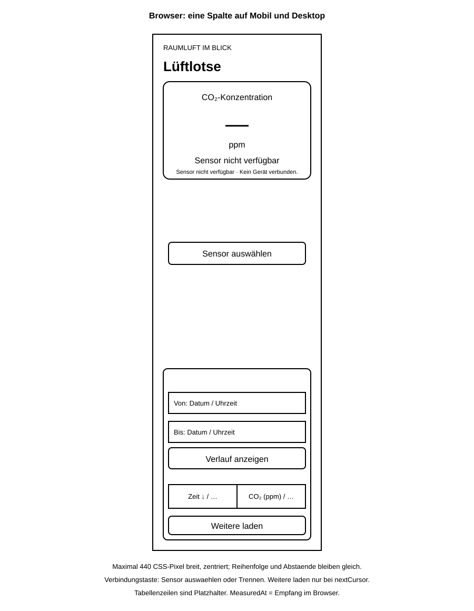
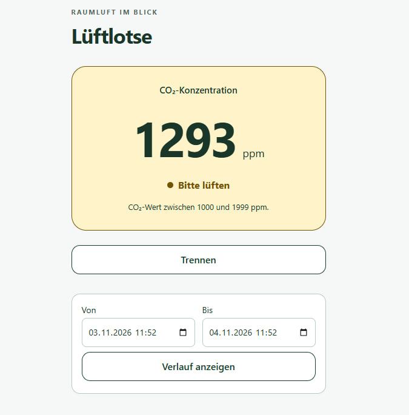

# Vergleich von Wireframe und fertiger Oberfläche

## Nachträglich erstellter Wireframe

*Wireframe der Browseroberfläche.*

Browser und Android verwenden auf allen Bildschirmbreiten dieselbe einzelne
Spalte: CO₂-Karte, Sensorverbindung und Serververlauf folgen untereinander.
Der Inhalt ist maximal 440 CSS-Pixel breit und auf großen Bildschirmen zentriert.
Reihenfolge und Abstände bleiben gleich; es gibt keine Desktop-Zweispaltenansicht.
Die Hauptansicht ist auf beiden Plattformen gleich; Bluetooth-Anbindung,
Berechtigungen und die Android-Hintergrunddienst-Implementierung bleiben
plattformabhängig.

Der Wireframe wurde nach der Implementierung anhand der vorhandenen
Browseroberfläche erstellt. Er ist eine vereinfachte Schwarz-Weiß-Darstellung
und kein ursprünglicher Entwurf. Die Verbindungstaste ist immer sichtbar und
hat keine äußere Taste „Sensor verbinden“ oder aufklappbare Umrandung.
Filter und Ergebnisse des Serververlaufs sind immer sichtbar; es gibt keine
äußere Taste zum Aufklappen. Die Taste **Verlauf anzeigen** lädt den gewählten
Zeitraum. Die Filter heißen **Von** und **Bis**; Bis bleibt die exklusive Grenze
in lokaler Zeit.
Auf beiden Plattformen gibt es nur eine sichtbare Historie:
**Verlauf anzeigen** lädt den Serververlauf. Lokale Historie und manuelle
Synchronisierung werden dort nicht angezeigt. Tabellenzeilen sind Platzhalter. **Weitere laden** erscheint im
fertigen Programm nur, wenn die Serverantwort einen `nextCursor` enthält.

Empfangene LIVE_SAMPLE werden angezeigt, lokal in IndexedDB gespeichert und
automatisch über die C# API nach PostgreSQL übertragen. MeasuredAt ist die
Empfangszeit im Browser. Ohne Verbindung verpasste Messungen werden nicht
nachgeliefert. Lokaler Puffer, Deduplication und automatische Übertragung bleiben
trotz ausgeblendeter lokaler Historie erhalten. Diese Speicherung empfangener
LIVE_SAMPLE bleibt eine Browserfunktion; der gemeinsame UI-Code verändert
die Android-Speicher- und Übertragungswege nicht.
Die Sensorauswahl öffnet den bestehenden Gerätedialog von Chrome. Eine einzige
Taste zeigt ohne Verbindung **Sensor auswählen**, mit Verbindung **Trennen**.
Auf Android öffnet dieselbe Taste einen vorübergehenden Auswahldialog mit dem
bestehenden BLE-Scanner. Die gespeicherte Bindung wird nur mit dem ausdrücklichen
Schritt **Gerät vergessen** im Dialog entfernt. Das ist ein technischer
Plattformunterschied der Geräteauswahl, keine zweite Hauptansicht.
Der Serververlauf bietet den vorhandenen Zeitraumfilter, **Verlauf anzeigen** sowie die
Spalten **Zeit** und **CO₂ (ppm)**. **Quelle** wird nicht angezeigt;
das Feld Source bleibt in Daten und API erhalten. Die Überschriften **Zeit**
und **CO₂ (ppm)** sortieren auf beiden Plattformen per
Klick den gesamten gewählten Zeitraum; ein weiterer Klick kehrt die Richtung um.
Ein Pfeil markiert die aktive Sortierung. Standardmäßig stehen neue Messungen
oben. Ein Sortierwechsel lädt die erste Serverseite neu; weitere Seiten folgen
derselben Sortierung.
Die gemeinsame Tabelle hat keine zusätzliche Beschriftung über den Spalten.
Beide Spalten belegen jeweils 50 Prozent der Tabellenbreite; lange Datumswerte
werden bei Bedarf umgebrochen. Überschriften, Sortierpfeile und Zelleninhalte
sind in beiden Spalten zentriert. Gewöhnliche Verbindungsstatusmeldungen unter
der Verbindungstaste und die zusätzliche Schwellenwert-Legende entfallen;
Verbindungsfehler und die CO₂-Statusanzeige bleiben sichtbar.

## Screenshot der fertigen Anwendung

*Aktualisierter Screenshot der Browseroberfläche mit verbundenem Sensor:
eine Spalte, die Taste „Trennen“ sowie ständig sichtbare Von/Bis-Filter und
„Verlauf anzeigen“. In diesem Aufnahmezustand sind noch keine Tabellenzeilen
geladen; die sortierbare Tabelle ist im Wireframe schematisch dargestellt.*

Beim Vergleich stehen die Trennung von aktueller Sensoranzeige und Serverdaten,
die Anordnung der Bedienelemente und die reduzierte Tabelle im Vordergrund.
Farben, Symbole, exakte Abstände und responsive Details sind im Wireframe
bewusst vereinfacht.
